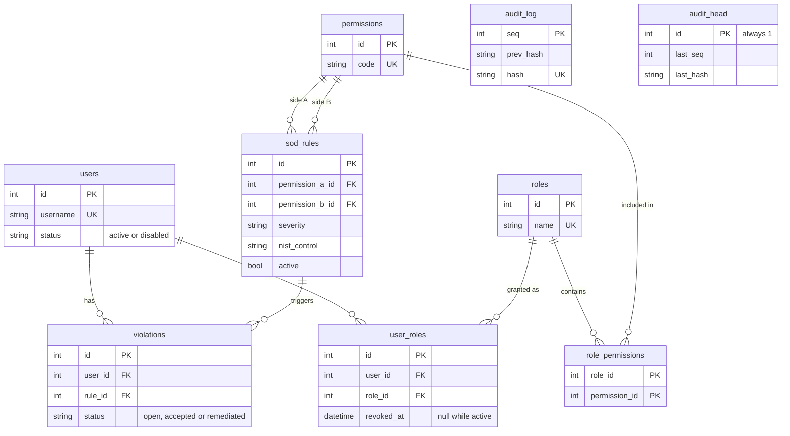

# Data model

`audit_log` and `audit_head` are not linked by foreign keys on purpose. The log is verified by recomputing hashes, not by trusting relationships.

## Constraints and why they exist

| Constraint | Reason |
| --- | --- |
| `users.username`, `roles.name`, `permissions.code`, `sod_rules.code` unique | Stable identifiers that people and the API refer to |
| `users.status` limited to `active` or `disabled` | A typo cannot create a third state the detection query would mishandle |
| Partial unique index on `user_roles (user_id, role_id) WHERE revoked_at IS NULL` | A role cannot be actively granted twice, but a revoked grant can be granted again later, and the history stays |
| `sod_rules.permission_a_id < permission_b_id` check plus a unique pair | A rule is stored once. `(A, B)` and `(B, A)` are the same rule, and a rule against itself is meaningless |
| `sod_rules.severity` check | Keeps scoring and blocking logic total |
| Partial unique index on `violations (user_id, rule_id) WHERE status <> 'remediated'` | At most one live violation per user and rule. Remediated rows stay as history, so a conflict that comes back opens a new row |
| `audit_head.id = 1` check | One head row, which doubles as the lock that serialises audit writes |
| `audit_log.hash` unique | An entry cannot be duplicated |
| Triggers on `audit_log` rejecting UPDATE and DELETE | Append-only at the database level, with a SQLite trigger and a PostgreSQL trigger function |
| Foreign keys everywhere, switched on explicitly for SQLite | SQLite ignores them unless asked |

## Design decisions

**Revoking sets `revoked_at` instead of deleting.** Access history is itself evidence. The cost is that every "current access" query filters on `revoked_at IS NULL`, which the partial index supports.

**Timestamps in the audit log are strings.** Hashing needs a byte-exact value, and datetime round trips differ across databases. A fixed ISO-8601 string with microseconds hashes identically everywhere.

**Violations are stored, not computed on demand.** A stored row can carry a status, an owner, a justification and a history, which an on-the-fly query cannot. The detection query remains the source of truth, and reconciliation keeps the stored rows in line with it.

**Severity blocks grants.** High and critical conflicts need an override with a written reason. Medium and low conflicts are allowed but flagged, so the control is strict where it matters and does not train people to click through warnings.

**Everything in one transaction.** A change and its audit entries commit or roll back together. A refused grant leaves nothing behind, not even an audit entry.
